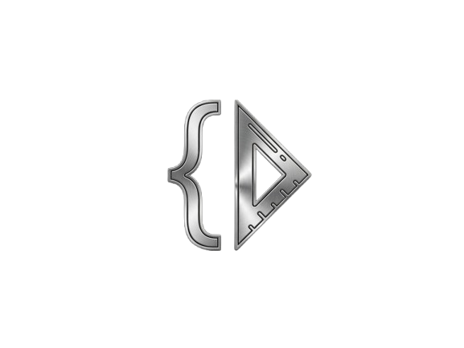

<p align="center">
  
</p>

<h1 align="center">Archbase</h1>

<p align="center">
  <strong>Architecture that AI coding agents can actually follow.</strong>
</p>

Archbase is an open-source Go CLI (`arc`) for sharing code patterns and architecture rules with developers and AI coding agents.

- **Patterns** define how a type of code is structured.
- **Rules** define paths, responsibilities, and dependency constraints.
- **Scopes** select the active pattern for each part of a project.

The built-in catalog works offline. Local patterns can be customized, rules can be exported to Cursor, GitHub Copilot, and `AGENTS.md`, and compatible agents can inspect project context through read-only MCP tools.

## Quick start

Install on Linux (official distribution):

```bash
curl -fsSL https://archbase.caetanodev.com/install.sh | sh
```

Open a new terminal, then run these commands from your project directory:

```bash
arc
arc version
arc add next/page@1234 .
arc resolve src/pages/Home.tsx
arc inspect next/page@1234
arc remove architecture/next-modular@1
```

Running `arc` in an interactive terminal opens a full-screen application with the silver ARCHBASE wordmark. Browse and search patterns and rules, inspect long documents, and use forms to install, create, export, or remove managed rules. Press `Ctrl+P` for the command palette and `Esc` to go back. See the [terminal UI guide](docs/terminal-ui.md) for navigation and shortcuts.

Direct commands still work in your shell, with formatted help, tables, and readable sections. Use `arc --plain` to keep the welcome screen instead of opening the application, or `arc --plain <command>` for the original text output. Redirected output stays plain automatically. `TERM=dumb` disables the UI and rich formatting; a non-empty `NO_COLOR` disables colors while keeping interactive navigation. Use `arc --help` for the full command reference.

`arc add` and `arc create` use the current directory as the project root; pass `--project-root <path>` to choose another. All scopes live in the single root `.archbase/scopes.yaml`, with independent pattern copies in `.archbase/patterns/<scope-hash>/<pattern-hash>`. Examples such as `Example.tsx.md` contain typed Markdown code blocks, keeping reference code out of project compiler inputs. `arc resolve` selects the most specific scope even when the target file does not exist yet. Use its printed root to locate and edit examples. See [workspace layout](docs/workspace.md).

`arc remove <rule-id>` removes that rule's managed Cursor, Copilot, and `AGENTS.md` exports. `arc remove --all` removes every Archbase-managed rule export in the project while preserving unrelated files and external `AGENTS.md` content.

macOS and Windows are available as **unsigned previews**. See the [installation guide](docs/installation.md) for requirements, manual installation, and removal.

## Documentation

| Guide | Contents |
| --- | --- |
| [Installation](docs/installation.md) | Installers, supported platforms, checksums, and uninstall. |
| [Getting started](docs/getting-started.md) | Complete workflow with patterns, customization, rules, and MCP. |
| [Terminal UI](docs/terminal-ui.md) | Interactive navigation, forms, long documents, and plain output. |
| [Concepts](docs/concepts.md) | Patterns, nested scopes, resolution, and local customization. |
| [Registry](docs/registry.md) | Pattern catalog, public Git sources, caching, and validation. |
| [Architecture rules](docs/rules.md) | Rule catalog and exports for Cursor, Copilot, and `AGENTS.md`. |
| [MCP](docs/mcp.md) | Read-only tools, client configuration, and project boundaries. |
| [Schemas](docs/schemas.md) | Public YAML contracts and versioning. |
| [Development](docs/development.md) | Build, validation, contributions, and release workflow. |
| [Code signing](docs/code-signing-policy.md) | Current signing status and release integrity policy. |
| [Privacy](docs/privacy.md) | Network access and local data. |

## License and maintainer

[MIT License](LICENSE). Maintained by [Enzo Caetano](https://github.com/EnzoCaetano015). Archbase does not collect telemetry or personal data.

Download published versions from [GitHub Releases](https://github.com/EnzoCaetano015/Archbase/releases/latest).
